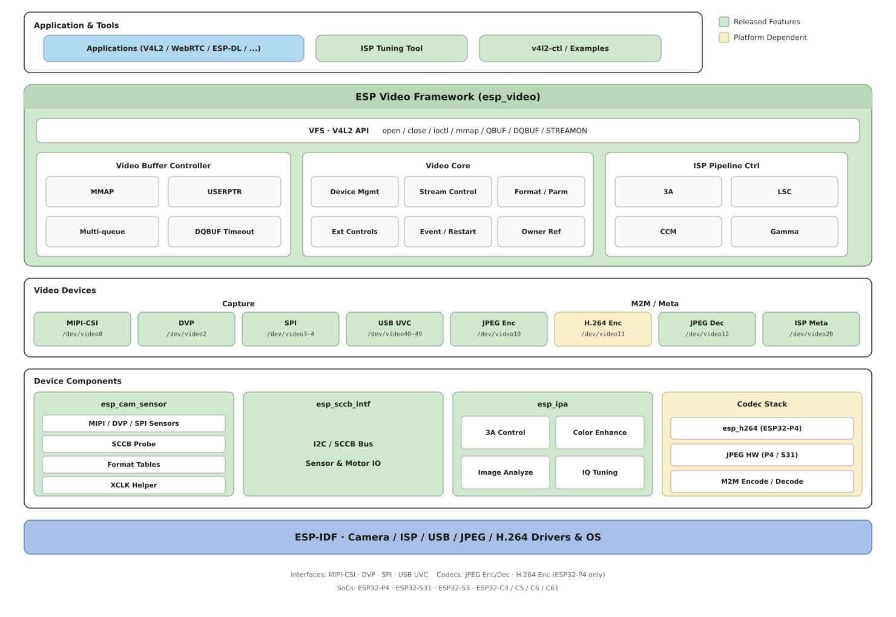
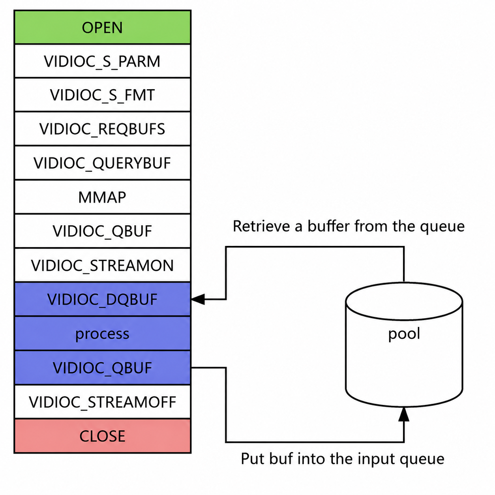

***************************************
ESP Video Application Development Guide
***************************************

:link_to_translation:`zh_CN:[中文]`

Overview
--------

The ``esp_video`` component provides video capture and image processing for Espressif ESP32 series chips. This component implements some of the functionality defined by the Linux V4L2 (Video for Linux Two) specification, encapsulates low-level implementations such as camera sensor drivers, the ISP (Image Signal Processor), and hardware codecs, and exposes unified device nodes, such as ``/dev/video0``, to upper layers. Applications can follow the common V4L2 capture flow, reducing platform adaptation costs.

The main design characteristics are as follows:

- **Standards compliance**: The API follows a subset of the V4L2 specification and supports common ioctls, request codes, and buffer streaming, which makes it easier to migrate and reuse existing Linux applications.
- **Layered architecture**: The upper layer provides standard application interfaces, the middle layer is responsible for device management and buffer control, and the lower layer connects to hardware drivers and responds to callbacks, making it easier to extend support to a variety of camera sensors.
- **Efficient queues**: Multiple buffer queues are supported, including MMAP, USERPTR, and other modes, for high-frame-rate, low-latency capture.
- **Flexible adaptation**: The underlying HAL (Hardware Abstraction Layer) adapts, in a plug-in manner, to different camera sensors, ISP modules, and codec modules, covering a variety of ESP32 series chips.
- **Easy to build on**: Interfaces, structures, and return codes follow V4L2 and industry practice, and the memory and performance trade-offs suit embedded platforms.

This guide introduces, in reading order, the software architecture, hardware capabilities and device nodes, the data path, and project integration and application programming. For ioctl request codes and command parameters, see :doc:`commands`. For initialization APIs, see :doc:`api_reference`.

.. toctree::
   :maxdepth: 1
   :hidden:

   Commands <commands>
   API Reference <api_reference>

Software Architecture
---------------------

``esp_video`` uses a layered design: the application accesses device nodes through V4L2 ioctls; the middle layer performs device management, format negotiation, and buffer queuing; the lower layer connects, through the HAL, to MIPI-CSI, DVP, SPI, USB, ISP, and hardware codec drivers. The layered structure is shown in the figure below.

   esp_video Layered Architecture

Hardware and Device Nodes
-------------------------

Chips and Peripherals
^^^^^^^^^^^^^^^^^^^^^

The camera interfaces and codec peripherals available on each chip are as follows. Whether a given device can actually be used also depends on whether the corresponding option is enabled in menuconfig.

.. list-table::
   :header-rows: 1
   :width: 100%
   :widths: auto
   :align: left

   * - SoC
     - MIPI-CSI
     - DVP
     - SPI
     - JPEG Encoder
     - JPEG Decoder
     - H.264 Encoder
     - ISP
     - USB
   * - ESP32-P4
     - Y
     - Y
     - Y
     - Y
     - Y
     - Y
     - Y
     - Y
   * - ESP32-S31
     - N
     - Y
     - Y
     - Y
     - Y
     - N
     - N
     - Y
   * - ESP32-S3
     - N
     - Y
     - Y
     - N
     - N
     - N
     - N
     - Y
   * - ESP32-C3
     - N
     - N
     - Y
     - N
     - N
     - N
     - N
     - N
   * - ESP32-C5
     - N
     - N
     - Y
     - N
     - N
     - N
     - N
     - N
   * - ESP32-C6
     - N
     - N
     - Y
     - N
     - N
     - N
     - N
     - N
   * - ESP32-C61
     - N
     - N
     - Y
     - N
     - N
     - N
     - N
     - N

.. note::

   1. When the ISP is enabled, MIPI-CSI supports input images in RAW8/RAW10 format and output images in RAW8/RGB888/RGB565/YUV420/YUV422(UYVY) format. When the ISP is disabled, MIPI-CSI directly outputs the image produced by the camera sensor.

   2. ESP32-P4 v3.0 and later chips add image format conversion inside the MIPI-CSI module, which can convert input RGB888/RGB565/YUV420/YUV422(UYVY/YUYV/VYUY/YVYU) into the same class of formats listed above.

   3. An SPI camera can receive images with only 3 pins: V-SYNC, PCLK (Pixel Clock), and Data. To increase the frame rate and resolution, increase the Data bit width (for example, to 2 or 4 bits). That also uses more pins. After ``ESP_VIDEO_ENABLE_THE_SECOND_SPI_VIDEO_DEVICE`` is enabled, the second SPI device ``/dev/video4`` is available.

   4. The JPEG hardware encoder and decoder are available on chips with an integrated JPEG codec (ESP32-P4 and ESP32-S31). The H.264 hardware encoder is available only on ESP32-P4. An H.264 hardware decoder device is not provided currently.

   5. On ESP32-P4 ECO3 and later, the JPEG hardware encoder additionally supports ``V4L2_PIX_FMT_YUV420`` and ``V4L2_PIX_FMT_YUV444``; the JPEG hardware decoder additionally supports ``V4L2_PIX_FMT_YUV420``. The decoder also supports swapping the RGB channel order, and can therefore output BGR565/BGR888.

Device Nodes
^^^^^^^^^^^^

``esp_video`` manages MIPI-CSI, DVP, SPI, USB, the JPEG/H.264 codecs, and the ISP through device nodes (file descriptors). In the table below, **Capture** means a capture device, **M2M** means a Memory-to-Memory video codec device, and **Meta** means a metadata device.

.. list-table::
   :header-rows: 1
   :width: 100%
   :widths: auto
   :align: left

   * - Hardware
     - Video Device
     - Type
     - Input Format
     - Output Format
   * - MIPI-CSI
     - /dev/video0
     - Capture
     - /
     - Sensor output format, or the format after ISP processing
   * - DVP
     - /dev/video2
     - Capture
     - /
     - Sensor output format
   * - SPI (0–1)
     - /dev/video3–4
     - Capture
     - /
     - Sensor output format
   * - USB UVC (0–9)
     - /dev/video40–49
     - Capture
     - /
     - Sensor output format
   * - JPEG Hardware Encoder
     - /dev/video10
     - M2M
     - RGB565/RGB888/YUV422(UYVY)/Gray8/YUV420/YUV444
     - JPEG (``V4L2_PIX_FMT_JPEG``)
   * - H.264 Hardware Encoder
     - /dev/video11
     - M2M
     - YUV420 (``V4L2_PIX_FMT_YUV420``)
     - H.264 (``V4L2_PIX_FMT_H264``)
   * - JPEG Hardware Decoder
     - /dev/video12
     - M2M
     - JPEG (``V4L2_PIX_FMT_JPEG``)
     - RGB565/BGR565/RGB888/BGR888/YUV422(UYVY)/Gray8/YUV420/YUV444
   * - ISP
     - /dev/video20
     - Meta
     - Sensor output format
     - Metadata (``V4L2_META_FMT_ESP_ISP_STATS``)

.. _esp-video-data-path:

Data Path
---------

Image data can be read directly from a Capture device, or sent to an M2M device for encoding or decoding. Buffer queues run through the whole path. A camera sensor that outputs RAW also needs the ISP and IPA (Image Processing Algorithms) for real-time closed-loop control.

Capture Devices and M2M Devices
^^^^^^^^^^^^^^^^^^^^^^^^^^^^^^^

A Capture device captures images from the camera interface. The component also supports `M2M <https://www.kernel.org/doc/html/v6.1/userspace-api/media/v4l/dev-encoder.html>`__ devices: the application sends a buffer into one end of the codec and takes the encoded or decoded data from the other end. Node paths and pixel formats are in the table in the previous section.

The hardware codecs include:

- **JPEG encoder** (``/dev/video10``): Compresses RGB/YUV into JPEG.
- **H.264 encoder** (``/dev/video11``, ESP32-P4 only): Compresses YUV420 into H.264.
- **JPEG decoder** (``/dev/video12``): Decompresses JPEG into RGB/YUV. Use it for USB UVC MJPEG streams, for decoding stored files, and for a pipeline that decodes JPEG and then encodes H.264.

Typical steps for **encoding** through an M2M device:

1. Call ``DQBUF`` on the Capture device to obtain the frame buffer that holds the sensor data.
2. Feed that buffer, through ``QBUF``, into the **OUTPUT** (input) queue of the M2M encoder.
3. The M2M device passes the input to the encoder.
4. After encoding completes, the result enters the **CAPTURE** (output) queue of the M2M device.
5. Call ``DQBUF`` on the M2M device to take out the encoded data.

The **decoding** flow is similar, except that the input is a JPEG bitstream and the output is a pixel format:

1. Call ``QBUF`` to send the JPEG data to the OUTPUT queue of the JPEG decode device.
2. After decoding completes, call ``DQBUF`` on the JPEG decode device to retrieve the RGB/YUV image from the CAPTURE queue.

.. code-block:: none

    **********************   YUV/RGB    ********       *************
    * Encoder            * <----------- * V4L2 * <---- * Program   *
    * (JPEG/H.264)       * -----------> * M2M  * ----> *           *
    **********************  JPEG/H.264  ********       *************

    **********************    JPEG      ********       *************
    * Decoder            * <----------- * V4L2 * <---- * Program   *
    * (JPEG)             * -----------> * M2M  * ----> *           *
    **********************   YUV/RGB    ********       *************

.. _esp-video-buffer-queues:

Buffer Queues
^^^^^^^^^^^^^

The video buffer manager keeps a buffer queue for each device. An application reads images by repeatedly enqueuing (``QBUF``) and dequeuing (``DQBUF``) buffers:

.. code-block:: none

    *************************************************
    *                  Application                  *
    *************************************************
       |                                       ^
       | Enqueue (QBUF)                        | Dequeue (DQBUF)
       v                                       |
     ********    ********     ********    ********
     * buf  *--->* buf  *---> * buf  *--->* buf  *
     ********    ********     ********    ********

Two types of buffers are commonly used in the system:

- **Capture**: Receives the captured result. For an M2M encoder, this is the encoded bitstream; for the JPEG decoder, this is the decoded pixel data.
- **Output**: Feeds an image into the encoder input, or feeds a JPEG bitstream into the decoder input.

When an M2M encoder is used, the two types of buffers work with ``QBUF``/``DQBUF`` as follows:

.. code-block:: none

    **********  DQBUF
    * cap_fd * --------> Dequeue filled raw image buffer from cap_fd receive queue
    **********                                                                     |
    *                                                                              |
    *                                                                              v
    *                                                                      QBUF **********
    * Enqueue raw buffer to m2m_fd OUTPUT queue    <--------------------------- * m2m_fd *
    * |                                                                         **********
    * |
    * v
    **********  DQBUF
    * m2m_fd * -------> Dequeue the encoded image data from the CAPTURE queue of m2m_fd
    **********

ISP Real-Time Control
^^^^^^^^^^^^^^^^^^^^^

When light, contrast, or color temperature changes, the ISP pipeline and the camera sensor parameters need to be updated accordingly. ``esp_video`` adjusts the parameters of each sub-device according to scene changes. A typical data flow is as follows:

.. seqdiag::
    :caption: esp-ipa Control Loop
    :align: center

    seqdiag esp-ipa-control-loop {
        activation = none;
        node_width = 100;
        node_height = 65;
        edge_length = 160;
        span_height = 5;
        default_shape = roundedbox;
        default_fontsize = 12;

        SENSOR [label = "sensor"];
        ISP [label = "ISP"];
        ESP_IPA [label = "IPA\nlibrary"];

        SENSOR -> ISP [label="1.1 > images, frame metadata"];
        ISP -> ESP_IPA [label="1.2 > frame metadata, image statistics"];
        ESP_IPA -> SENSOR [label="2.1 > exposure time, gain"];
        ESP_IPA -> ISP [label="2.2 > ISP parameters"];
    }

1. Statistics stage

    - 1.1: The camera sensor sends the image to the ISP.
    - 1.2: The ISP generates brightness and color statistics from the image and sends them to the IPA.

2. Control dispatch stage

    - 2.1: The `IPA <https://github.com/espressif/esp-video-components/tree/master/esp_ipa>`__ sends brightness controls such as exposure and gain to the sensor according to the statistics.
    - 2.2: The IPA sends brightness and color parameters to the ISP based on the statistics.

How to Use esp_video
--------------------

Add the Component
^^^^^^^^^^^^^^^^^

Run ``idf.py add-dependency "espressif/esp_video=*"`` in the project directory. For more information, see `IDF Component Manager <https://docs.espressif.com/projects/esp-idf/en/latest/esp32/api-guides/tools/idf-component-manager.html>`__.

Menu Configuration
^^^^^^^^^^^^^^^^^^

Enable the required camera interfaces and codec devices:

.. code-block:: none

    Component config  --->
     Espressif Video Configuration  --->
        [*] Enable MIPI-CSI based Video Device  --->
        [*] Enable DVP based Video Device  ----
        [ ] Enable SPI based Video Device  ----
        [ ] Enable Hardware H.264 based Video Device  ----
        [ ] Enable Hardware JPEG Encoder based Video Device  ----
        [ ] Enable Hardware JPEG Decode based Video Device  ----
        [*] Enable ISP based Video Device  --->

Enable the camera sensor connected to the device:

.. code-block:: none

    Component config  --->
     Espressif Camera Sensors Configurations  --->
      Camera Sensor Configuration  --->
         [*] OV2640  --->

Enable the IPA:

.. code-block:: none

    Component config  --->
     Espressif Video Configuration  --->
      Enable ISP based Video Device  --->
         [*] Enable ISP Pipeline Controller

.. attention::

    The IPA does not need to be enabled if the camera sensor outputs YUV/RGB directly.

Initialization Configuration
^^^^^^^^^^^^^^^^^^^^^^^^^^^^

Configure the initialization parameters in the application, and then call ``esp_video_init()``. This API probes the devices on the bus and loads the default configuration. For the complete parameter description, see :doc:`api_reference`.

.. code-block:: c

    #include "linux/videodev2.h"
    #include "esp_video_device.h"
    #include "esp_video_init.h"
    #include "esp_video_ioctl.h"

    static const esp_video_init_config_t s_cam_config = {
        .csi       = &s_csi_config,
        .cam_motor = &s_cam_motor_config,
        .dvp       = &s_dvp_config,
        .spi       = &s_spi_config,
    };
    /* Configure pins such as xclk, reset, and pwdn according to the camera sensor requirements */
    ...
    const esp_video_init_config_t *cam_config_ptr = &s_cam_config;
    esp_video_init(cam_config_ptr);

.. attention::

    For a camera sensor that outputs RAW, also check the IPA configuration files in the ``sensor/cfg`` directory to make sure the algorithm parameters can be loaded correctly.

.. _esp-video-application-programming:

Application Programming
^^^^^^^^^^^^^^^^^^^^^^^

The application operates devices through POSIX ``open``/``close`` and V4L2 ``ioctl``. The typical sequence is: open the device -> (optional) query capabilities and formats -> request and queue buffers -> ``STREAMON`` -> loop ``DQBUF``/``QBUF`` -> ``STREAMOFF`` -> close the device. An M2M device must request buffers and start and stop streaming separately for OUTPUT and CAPTURE. For request codes and command parameters, see :doc:`commands`.

The following figure shows how the ioctl calls relate to each other:

    ioctl Interface Programming Model

1. Open and close the device

   .. code:: c

       #include "esp_video_device.h"

       /* Device names are defined in esp_video_device.h */
       int fd = open(ESP_VIDEO_MIPI_CSI_DEVICE_NAME, O_RDWR);
       ...
       close(fd);

2. Query device capabilities (optional)

   .. code:: c

       ioctl(fd, VIDIOC_QUERYCAP, &capability);
       if (capability.capabilities & V4L2_CAP_VIDEO_OUTPUT) {
           printf("Display capability is supported\n");
       }

3. Query and set the data format (optional)

   .. code:: c

       /* Enumerate supported formats */
       ioctl(fd, VIDIOC_ENUM_FMT, &fmtdesc);

       /* Query the current format */
       ioctl(fd, VIDIOC_G_FMT, &default_format);

       /* Set the format */
       ioctl(fd, VIDIOC_S_FMT, &format);

   .. attention::

       During probing, the device loads the default format from the configuration menu. Changing the format at runtime must be done while streaming is stopped.
       For a custom format, see the example ``esp_video/examples/video_custom_format``.

4. Buffer queue and data stream

   .. code:: c

       /* Request buffers */
       ioctl(fd, VIDIOC_REQBUFS, &req);

       /* Query the buffer to obtain the offset that can be mapped */
       ioctl(fd, VIDIOC_QUERYBUF, &buffer);

       /* addr is an address accessible from user space */
       uint8_t *addr;
       addr = mmap(NULL, buffer.length, PROT_READ | PROT_WRITE, MAP_SHARED,
                   fd, buffer.m.offset);

       /* Put the buffer into the queue and wait for it to be filled */
       if (ioctl(fd, VIDIOC_QBUF, &buf) != 0) {
           ESP_LOGE(TAG, "failed to queue video frame");
           close(fd);
           return -1;
       }

       /* Start streaming */
       if (ioctl(fd, VIDIOC_STREAMON, &type) != 0) {
           ESP_LOGE(TAG, "failed to start stream");
           close(fd);
           return -1;
       }

       /* Take out the filled buffer */
       if (ioctl(fd, VIDIOC_DQBUF, &buf) != 0) {
           ESP_LOGE(TAG, "failed to receive video frame");
           close(fd);
           return -1;
       }

       /* Stop streaming */
       if (ioctl(fd, VIDIOC_STREAMOFF, &type) != 0) {
           ESP_LOGE(TAG, "failed to stop stream");
           close(fd);
           return -1;
       }

Application Examples
--------------------

The repository examples listed below complement the :ref:`Data Path <esp-video-data-path>` and :ref:`Buffer Queues <esp-video-buffer-queues>` sections above.

* `capture_stream <https://github.com/espressif/esp-video-components/tree/master/esp_video/examples/capture_stream>`__ demonstrates how to open a video device and capture images.
* `m2m <https://github.com/espressif/esp-video-components/tree/master/esp_video/examples/m2m>`__ demonstrates how to perform three kinds of processing through an M2M device: hardware JPEG/H.264 encoding after capture, hardware decoding of a JPEG bitstream, and JPEG decoding followed by H.264 encoding.
* `image_storage <https://github.com/espressif/esp-video-components/tree/master/esp_video/examples/image_storage>`__ demonstrates how to store images and video streams to an SD card or flash.
* `simple_video_server <https://github.com/espressif/esp-video-components/tree/master/esp_video/examples/simple_video_server>`__ demonstrates how to set up a local server so that images can be previewed and downloaded in a browser.
* `uvc <https://github.com/espressif/esp-video-components/tree/master/esp_video/examples/uvc>`__ demonstrates how to output the camera picture to a PC over USB.
* `v4l2_cmd <https://github.com/espressif/esp-video-components/tree/master/esp_video/examples/v4l2_cmd>`__ demonstrates how to control a V4L2 video device with commands similar to v4l2-utils.
* `video_custom_format <https://github.com/espressif/esp-video-components/tree/master/esp_video/examples/video_custom_format>`__ demonstrates how to initialize the video system with a custom format description.
