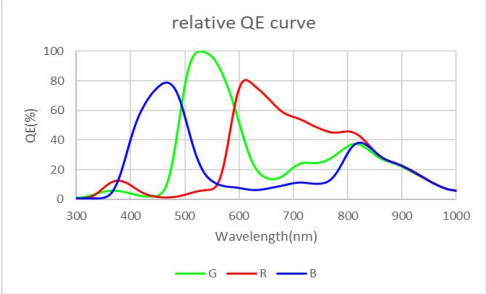

************************
Infrared Night Vision
************************

:link_to_translation:`zh_CN:[中文]`

Infrared night vision keeps one camera in color during the day. When the scene is dark, it moves the IR-cut filter out of the optical path, turns on the IR illuminator, and outputs a grayscale image. The ``esp_ipa`` IR algorithm decides when to switch from environment luma. With the ISP pipeline controller enabled, the pipeline applies the filter, the illuminator, saturation, and the night color parameters. The application does not send a command on every frame.

Goals and Use Cases
-------------------

Infrared night vision captures images at night or in low light. A movable IR-cut filter selects visible light or near infrared, so the same camera covers daytime color and nighttime grayscale. Typical uses:

1. **Security**

   - Night monitoring of homes, shops, and warehouses, where the outline and behavior of a person must remain visible.
   - Outdoor areas such as community perimeters and parking lots, where a visible illuminator would cause light pollution or reveal the camera.
   - Sites that need concealed monitoring around the clock, such as prisons and military bases.

2. **Driver assistance**

   - Detect pedestrians, animals, or obstacles ahead and show a grayscale image on the instrument panel.
   - Rear view when there is no street lighting.

3. **Field observation**

   - Watch nocturnal animals, such as bats and night mammals, without disturbing them.
   - Anti-poaching and forest-fire monitoring.

4. **Industrial inspection**

   - Robots that inspect fully dark spaces such as underground pipes, mines, and tunnels.
   - Inspection inside equipment such as transformers and switchgear.

Requirement: the sensor outputs RAW, and an on-chip ISP provides luma and white-balance statistics, as on ESP32-P4. A YUV or RGB sensor that already performs color processing inside the sensor does not use the IR algorithm in ``esp_ipa``.

Problem
-------

Near infrared must be blocked during the day, or the color image shifts. At night the IR-cut filter must leave the optical path so near infrared can reach the sensor. Switching on image brightness alone oscillates: once the illuminator turns on, the image becomes bright and the algorithm switches straight back to day. Color interpolation under near infrared only produces false color.

This solution does three things:

- During the day it compares environment luma only. At night it multiplies luma by ``night_ir_factor``, then also requires the red and green AWB sums of this frame to be non-zero. A bright image with no usable white-balance sample stays in night mode.
- When the switch to night starts, saturation is set to 0 and the night AWB window, color-correction matrix, and red and blue gains are written. After the return-to-day transition ends, saturation, AWB, color temperature, and color correction publish again from their own tuning.
- A condition must hold for a keep time before a switch starts. After the switch, a transition time blocks further decisions until the filter has settled and exposure has converged again.

How It Works
------------

The IR-cut filter can move into or out of the optical path. During the day it stays in the path and blocks near infrared. At night it moves out, near infrared reaches the sensor, and the IR illuminator makes an image when there is no visible light.

The algorithm has four states: day, switching to night, night, and switching to day. It starts in day. ``ir_enable`` true means night. The pipeline then sets the filter to night and the illuminator to maximum brightness. ``ir_enable`` false sets the filter back to day and the illuminator to minimum brightness. The filter is mechanical and its travel time is not timed by software, so the illuminator and the filter are commanded in the same frame. A lamp that is not on this control path must still follow the same day/night state. Otherwise the lamp itself biases the luma decision.

Environment luma comes from the variable named by ``luma_env``. If the key is omitted, the variable is ``env.luma.avg``. JSON ``null`` or the string ``"NULL"`` means this frame has no luma: day stays day, night stays night, and the keep timer starts again. The algorithm does not read ``ir_led_on`` and does not compare G/R.

- **Day.** Luma above ``day_luma_threshold`` is bright and clears the keep timer. Luma that is not above the threshold must hold for ``day_keep_time_us`` before the switch to night starts. ``night_ir_factor`` and AWB are not used here.
- **Night.** Luma is multiplied by ``night_ir_factor`` before the comparison. After that, luma that is not above ``night_luma_threshold`` is dark. Luma above the threshold is bright only when this frame has AWB statistics and both the red and green sums are non-zero. Missing luma, dark luma, missing AWB, or a zero red or green sum counts as dark and clears the keep timer.

The two luma thresholds form hysteresis. ``night_ir_factor`` compensates for the luma jump when the illuminator turns on.

A switch runs in the order below. The algorithm does not judge during the transition time. The frame that ends the transition only completes the state change. That frame is not judged.

- **Start of the switch to night.** ``ir_enable`` becomes true, saturation is set to 0, and saturation, AWB, color temperature, and color correction stop. ``night_awb``, ``night_ccm``, ``night_red_gain``, and ``night_blue_gain`` are written in the same step. The algorithm then waits ``day_switch_night_time_us`` before entering the night state.
- **Start of the switch to day.** ``ir_enable`` becomes false. Saturation and the color modules stay stopped, so the image remains grayscale with the night color parameters. The algorithm then waits ``night_switch_day_time_us``. When the transition ends, saturation, AWB, color temperature, and color correction start again. On their next process they publish from their own tuning: the saturation, color-correction, and color-temperature table indexes are set to ``-1``, and AWB clears the applied statistics window.

If day and night need different IPA JSON files, the application calls ``esp_video_isp_pipeline_set_ipa_config()``. The IR algorithm does not change the configuration by itself.

.. code-block:: text

    day —— stays dark ——> switching to night —— transition ends ——> night
     ^                                                              │
     │                                                              │ stays bright, AWB R and G non-zero
     └—— transition ends —— switching to day <——————————————————————+

Hardware Requirements
---------------------

Software thresholds can only compensate for hardware that is already fixed. Do not tune IPA parameters, and do not treat soft focus, a dark image, or repeated switching as an algorithm fault, until the sensor's near-infrared response, lens transmission, filter, and illuminator are in place.

Camera Sensor
^^^^^^^^^^^^^

A standard CMOS or CCD sensor responds to near infrared. Silicon is sensitive from 350 nm to 1050 nm, but near-infrared quantum efficiency (QE) varies widely:

- **Consumer CMOS**: QE at 850 nm is often only 20% to 30%, and lower at 940 nm.
- **Near-infrared enhanced CMOS**: a thicker silicon epitaxial layer, a back-illuminated structure, or an in-pixel light trap can bring QE at 850 nm above 35%.

.. note::

   A longer wavelength has a lower absorption coefficient in silicon and needs a deeper absorption path. Within a limited photosensitive thickness, QE at 940 nm is usually lower than at 850 nm.

   Check the QE curve in the sensor datasheet at the target wavelength.

The figure below is the relative QE curve of SC2336. The R, G, and B channels differ in visible light. In near infrared they converge and fall. There is still a usable response near 850 nm, and it keeps falling toward 940 nm. For another sensor, use that sensor's datasheet. Do not reuse the numbers on this figure.

   SC2336 relative quantum-efficiency curve

Optics
^^^^^^

- **Lens**: coatings and cement must transmit near infrared. A visible-light lens loses transmission beyond 850 nm. For higher night image quality, use an IR-corrected lens.
- **Focus shift**: after the IR-cut filter leaves the path, infrared and visible light do not share a focal plane, so the night image is soft. For higher night image quality, use an IR-corrected lens, or run autofocus once when switching to night. Software cannot remove this optical defocus.
- **Filter**: three arrangements are common.

  - A fixed IR-cut filter always blocks infrared. Daytime color is accurate, and there is no night vision.
  - A switched dual filter (ICR) places the IR-cut filter during the day and replaces it with a clear glass at night. Security cameras usually use this arrangement, and this solution drives it.
  - Removing the IR-cut filter and adding an 850 nm band-pass filter passes only the target band. This is for a dedicated infrared system.

Illumination
^^^^^^^^^^^^

In complete darkness the sensor has no usable signal, so an active IR illuminator is required. On the frame where ``ir_enable`` changes, the pipeline sets the filter and the illuminator together. A lamp that is not on this path must still follow the same day/night state.

- **850 nm IR LED**: high sensitivity, with a visible red glow. Suitable for general monitoring.
- **940 nm IR LED**: invisible to the eye, with lower sensor QE and a shorter range at the same power.
- **Power and range**: a camera rated for 30 m often has a useful range of 15 m to 20 m. Grass and leaves scatter and absorb infrared, so detail needs a shorter distance or more power. After the wavelength is chosen, use ``night_ir_factor`` to compensate for the resulting luma difference.

ISP and Image Processing
^^^^^^^^^^^^^^^^^^^^^^^^

At night the ISP keeps its output format, and modules such as demosaic stay on the same pipeline. The grayscale image comes from saturation written as 0. The night AWB window, color-correction matrix, and red and blue gains come from ``night_awb``, ``night_ccm``, ``night_red_gain``, and ``night_blue_gain``. After the return-to-day transition ends, those modules publish again from their own tuning.

``V4L2_CID_IRCUT_MODE`` moves the filter. ``V4L2_CID_IR_LED_BRIGHTNESS`` sets the illuminator to maximum or minimum brightness. Both are independent of the output format and are applied on the same frame as the ``ir_enable`` change.

Near-infrared images also need lens-shading correction, denoising, gain control, and exposure adaptation. Otherwise the noise is heavy. AWB and color temperature are stopped during night mode, so convergence in that period is mainly luma.

How to Use
----------

Fit the sensor, lens, filter, and illuminator from the previous section first. Then connect the software in the order below. After the algorithm produces a result, the ISP pipeline controller sets the filter, illuminator, saturation, and night color parameters.

1. Enable the Drivers and the Algorithm
^^^^^^^^^^^^^^^^^^^^^^^^^^^^^^^^^^^^^^^^

Enable the IR-cut driver, the LED driver, IR-cut and LED control on the video device, the ISP pipeline, and the IR algorithm. The filter and the illuminator are currently provided by the MIPI-CSI video device. The illuminator option depends on the filter.

.. code-block:: none

    Component config  --->
     Espressif Camera Sensors Configurations  --->
      Camera IRCUT Control Configuration  --->
         [*] AP1511B  --->
      Camera LED Control Configuration  --->
         [*] IR2835
     Espressif Video Configuration  --->
      [*] Enable MIPI-CSI based Video Device  --->
         [*] Enable MIPI-CSI IR-Cut Support
         [*] Enable MIPI-CSI LED Support
      [*] Enable ISP based Video Device  --->
         [*] Enable ISP Pipeline Controller
     Espressif Image Process Algorithm Configuration  --->
        [*] IR Algorithm

``AP1511B`` waits 1000 ms by default after each switch. The time depends on the capacitor on the chip CE pin. Increase it when the filter moves slowly or sometimes sticks. The algorithm transition time should be at least the time the filter needs to settle.

2. Fill in the Pins
^^^^^^^^^^^^^^^^^^^

Attach the filter and the illuminator to the MIPI-CSI configuration passed to ``esp_video_init()``. ``ircut_chip_id`` set to ``0`` enables the filter. If there is no filter, omit ``ircut_config``, or set ``ircut_chip_id`` to ``255``. If there is no illuminator, omit ``led_config``, or set ``gpio_ctrl`` to ``-1``. Set unused pins to ``-1``.

.. code-block:: c

    static esp_video_init_ircut_config_t s_ircut_config = {
        .ircut_chip_id = 0,
        .fbc_pin = GPIO_NUM_10, /* FBC; -1 if not connected */
        .en_pin  = GPIO_NUM_11, /* EN; -1 if not connected */
    };

    static esp_video_init_led_config_t s_led_config = {
        .gpio_ctrl = GPIO_NUM_12, /* control pin; -1 if not connected */
        .gpio_en   = GPIO_NUM_13, /* enable pin; IR2835 does not drive it, use -1 if unused */
    };

    static const esp_video_init_csi_config_t s_csi_config = {
        .ircut_config = &s_ircut_config,
        .led_config = &s_led_config,
        /* fill SCCB, reset, pwdn, and the rest for the sensor */
    };

An example can enable ``Enable IR-Cut Control`` and ``Enable LED Control`` under ``Example Video Initialization Configuration`` and fill in the filter FBC and EN pins and the LED control and enable pins.

3. Add the IR Parameters at the End of the IPA JSON
^^^^^^^^^^^^^^^^^^^^^^^^^^^^^^^^^^^^^^^^^^^^^^^^^^^^

Put ``ir`` in the sensor IPA JSON under ``esp_cam_sensor/sensors/<sensor>/cfg/``, after the module that publishes ``luma_env``. It is usually the last entry of the sensor object. An earlier entry reads luma that has not been updated for this frame.

The numbers below show the relationship only. They are not product thresholds. Measure environment luma under a reference light first, then separate the two thresholds. Check day, dusk, and illuminated night with captured samples.

- ``day_luma_threshold`` controls entry into night mode. Set it far below the environment luma under the reference light. Luma that is not above it counts as dark. A lower threshold makes night mode harder to enter.
- ``night_luma_threshold`` controls the return to day. Set it far above the environment luma measured at night with the illuminator on. Luma can leave night mode only after it is above this threshold once multiplied by ``night_ir_factor``. A higher threshold makes the return harder.
- ``night_awb``, ``night_ccm``, and the red and blue gains are written when the switch to night starts. ``night_awb`` is the night AWB statistics window. It is not a day/night decision threshold.

.. code-block:: json

    "ir": {
        "model": 0,
        "model0_param": {
            "luma_env": "env.luma.avg",
            "day_luma_threshold": 5.0,
            "day_switch_night_time_us": 1500000,
            "day_keep_time_us": 2000000,
            "night_ir_factor": 10.0,
            "night_luma_threshold": 50.0,
            "night_switch_day_time_us": 3500000,
            "night_keep_time_us": 3000000,
            "night_awb": {
                "green": { "max": 255, "min": 0 },
                "rg": { "max": 1.5, "min": 0.5 },
                "bg": { "max": 1.5, "min": 0.5 }
            },
            "night_ccm": {
                "matrix": [
                    1.0, 0.0, 0.0,
                    0.0, 1.0, 0.0,
                    0.0, 0.0, 1.0
                ]
            },
            "night_red_gain": 1.0,
            "night_blue_gain": 1.0
        }
    }

.. list-table::
   :header-rows: 1
   :widths: 32 68

   * - Parameter
     - Role
   * - ``model``
     - Algorithm model. Only ``0`` exists. An omitted model is parsed as model 0.
   * - ``luma_env``
     - Environment-luma variable. The default is ``env.luma.avg``. JSON ``null`` or ``"NULL"`` means this frame has no luma, and the algorithm does not start a switch.
   * - ``day_luma_threshold``
     - Day luma threshold. Required. Luma above it is bright.
   * - ``day_keep_time_us``
     - How long day must stay dark before the switch to night starts, in microseconds. Required.
   * - ``day_switch_night_time_us``
     - Transition time after the switch to night starts, in microseconds. The default is ``0``. No decision is made during the transition. Cover filter travel and exposure convergence.
   * - ``night_ir_factor``
     - Multiplier applied to environment luma at night. The default is ``1.0``. Keep ``1.0`` when there is no illuminator.
   * - ``night_luma_threshold``
     - Night luma threshold. Required. Luma multiplied by ``night_ir_factor`` must be above it before the frame can count as bright.
   * - ``night_keep_time_us``
     - How long night must stay bright, with non-zero AWB red and green sums, before the switch to day starts, in microseconds. Required.
   * - ``night_switch_day_time_us``
     - Transition time after the switch to day starts, in microseconds. The default is ``0``. Grayscale and the night color parameters remain until it ends. The color modules then resume.
   * - ``night_awb``
     - AWB statistics window written when the switch to night starts. Required. ``green``, ``rg``, and ``bg`` each need ``max`` and ``min``.
   * - ``night_ccm``
     - Color-correction matrix written when the switch to night starts. Required. ``matrix`` is nine floats in row order.
   * - ``night_red_gain`` / ``night_blue_gain``
     - Red and blue gains written when the switch to night starts. Required.
   * - ``enable_log``
     - When true, each frame logs luma and whether the frame was skipped. The default is false. Turn it off in a release build.

4. No Per-Frame Control After Start
^^^^^^^^^^^^^^^^^^^^^^^^^^^^^^^^^^^^

``esp_video_init()`` probes the filter and the illuminator and attaches them to the MIPI-CSI video device. While the ISP pipeline is running, a switch from the algorithm sets the filter, illuminator, saturation, and night color parameters. The application captures images as before.

Each pipeline cycle must publish ``luma_env``. If the variable is missing, that frame does not start a switch and the keep timer is cleared. If the variable stays at an old value, the keep time continues to accumulate on that old luma.

Set ``V4L2_CID_IRCUT_MODE`` on the **camera device** (MIPI-CSI, not the ISP device) only when the IR algorithm is disabled and the application decides day and night itself. ``ESP_CAM_IRCUT_MODE_DAY`` is day. ``ESP_CAM_IRCUT_MODE_NIGHT`` is night. This command only moves the filter. Set illuminator brightness separately with ``V4L2_CID_IR_LED_BRIGHTNESS``. The range comes from the LED driver. Once the IR algorithm is enabled, the next automatic decision overwrites a manual filter or illuminator setting.

Tuning
------

If the hardware from the previous section is not ready, go back to sensor QE, the lens, and the lamp. Soft focus, a dark image, and insufficient illumination cannot be repaired by thresholds.

- Decide whether the illuminator follows night mode, then measure environment luma. Calibrate the thresholds after that lamp policy is fixed.
- Night mode starts too early in the day: lower ``day_luma_threshold``, or lengthen ``day_keep_time_us``. Entry requires luma that is not above the threshold, so a higher threshold is easier to treat as dark.
- Night mode never returns to day: raise ``night_ir_factor``, or lower ``night_luma_threshold``. If luma is already above the threshold, check whether the AWB red or green sum is 0. A frame with no white sample stays in night mode.
- The mode flips near the two thresholds: increase the gap between the thresholds, and lengthen the keep time and the transition time.
- Turn on ``enable_log`` and compare the logged luma with the scene. Turn it off in a release build.
