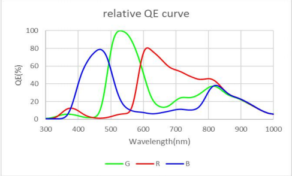

****************
红外夜视
****************

:link_to_translation:`en:[English]`

红外夜视让同一路相机在白天输出彩色，在光照不足时移开红外线截止滤光片、打开红外补光灯，并输出黑白。``esp_ipa`` 的红外算法根据环境亮度决定何时切换。启用 ISP 流水线后，滤光片、补光灯、饱和度和夜间色彩参数由流水线自动下发，应用不必每帧下发命令。

目标与适用场景
--------------

红外夜视用于夜间或光照不足时成像：可移动的红外线截止滤光片在可见光与近红外之间切换，同一路相机兼顾白天彩色和夜间黑白。适用于以下场景：

1. **安防监控**

   - 家庭、商铺、仓库的夜间监控，要求看清人物轮廓和行为。
   - 小区周界、停车场等室外区域，避免可见光补光造成光污染或暴露摄像头位置。
   - 监狱、军事基地等高安全等级场所的 24 小时隐蔽监控。

2. **车载辅助驾驶**

   - 探测前方行人、动物或障碍物，在仪表上显示黑白图像。
   - 无路灯时的倒车影像。

3. **野外监测与生态研究**

   - 夜间观察蝙蝠、夜行哺乳动物等，不惊扰动物。
   - 防盗猎、森林防火监控。

4. **工业与管道检测**

   - 地下管道、矿井、隧道等黑暗环境的巡检机器人。
   - 变压器、开关柜等设备内部的巡检。

适用前提：传感器输出 RAW，并由片上 ISP 统计亮度与白平衡，例如 ESP32-P4。已在传感器内部完成彩色处理的 YUV/RGB 传感器不使用 ``esp_ipa`` 中的红外算法。

解决的问题
----------

白天必须挡住近红外，否则彩色偏色。夜间移开红外线截止滤光片，近红外才能到达传感器。只按画面亮暗切换会振荡：补光灯点亮后画面变亮，算法会立刻切回白天。近红外下继续做彩色插值只会得到假色。

本方案处理这三件事：

- 白天只比较环境亮度。夜视先把亮度乘 ``night_ir_factor``，再要求本帧白平衡统计里红、绿通道之和都不为 0。补光把画面照亮，但没有有效白平衡样本时，仍留在夜视。
- 开始进入夜视时把饱和度设为 0，并写入夜间的白平衡统计窗、色彩校正矩阵和红蓝增益。回到白天的过渡结束后，饱和度、白平衡、色温和色彩校正按各自的调参重新输出。
- 条件要连续成立一段保持时间才开始切换。切换之后有一段过渡时间，这段时间不再判断，等滤光片到位、曝光重新收敛。

方案原理
--------

硬件上，红外线截止滤光片可移入或移出光路。白天滤光片留在光路中，挡住近红外。夜间滤光片移出，近红外到达传感器；此时打开红外补光灯，即可在没有可见光的环境下成像。

算法有四个状态：白天、切到夜视、夜视、切回白天。上电进入白天。``ir_enable`` 为真表示夜视，流水线据此把滤光片切到夜间，并把补光灯开到最大亮度；为假则把滤光片切回白天，并把灯关到最小亮度。滤光片是机械装置，行程时间不由软件控制，因此灯与滤光片在同一帧下发。未走这路控制的灯仍须与滤光片保持同一日夜状态，否则亮度判断会被灯的开关带偏。

环境亮度来自 ``luma_env`` 指定的变量。省略该键时使用 ``env.luma.avg``。写成 JSON ``null`` 或字符串 ``"NULL"`` 时，这一帧没有亮度：白天保持白天，夜视保持夜视，保持计时重新开始。算法不读取 ``ir_led_on``，也不比较 G/R。

- **白天**。亮度高于 ``day_luma_threshold`` 为亮，保持计时清零。不高于该门限，并连续保持 ``day_keep_time_us``，才开始切到夜视。这里不乘 ``night_ir_factor``，也不看白平衡。
- **夜视**。比较前先把亮度乘 ``night_ir_factor``。乘完后不高于 ``night_luma_threshold`` 为暗。高于该门限时，还要本帧带有白平衡统计，且红、绿通道之和都不为 0，才算亮。没有亮度、亮度偏暗、没有白平衡统计，或红、绿通道之和有一个为 0，都当作暗，保持计时清零。

两套亮度门限形成滞回。``night_ir_factor`` 用来抵消补光灯点亮后的亮度跳变。

一次切换的顺序如下。过渡时间内不再判断。过渡时间走完的那一帧只完成状态切换，这一帧不做亮度判断。

- **开始切到夜视**：``ir_enable`` 置真，饱和度设为 0，并停止饱和度、白平衡、色温和色彩校正。同时写入 ``night_awb``、``night_ccm``、``night_red_gain`` 和 ``night_blue_gain``。随后等待 ``day_switch_night_time_us``，再进入夜视状态。
- **开始切回白天**：``ir_enable`` 置假。饱和度和色彩模块仍停止，画面保持黑白和夜间色彩参数。随后等待 ``night_switch_day_time_us``。过渡结束后重新打开饱和度、白平衡、色温和色彩校正。这些模块在下一次处理时按自己的调参表重发：饱和度、色彩校正和色温的表索引置为 ``-1``，白平衡清掉已应用的统计窗。

日夜若要使用两份 IPA JSON，由应用调用 ``esp_video_isp_pipeline_set_ipa_config()`` 更换。红外算法不会自行更换配置。

.. code-block:: text

    白天 ——持续偏暗——> 切到夜视（过渡）——过渡结束——> 夜视
     ^                                              │
     │                                              │ 持续偏亮，且 AWB 的 R、G 非 0
     └——过渡结束—— 切回白天（过渡） <———————————————+

硬件需求
--------

软件门限只能在硬件已经确定之后做补偿。传感器近红外响应、镜头透过率、滤光片方案和补光灯没就绪时，先不要调 IPA 参数，也不要把虚焦、看不清、来回切换都当成算法问题。

相机传感器选型要点
^^^^^^^^^^^^^^^^^^

标准 CMOS / CCD 对近红外有响应，硅在 350–1050 nm 都能感光，但近红外量子效率（QE）差异很大：

- **普通消费级 CMOS**：850 nm 处 QE 大约只有 20%～30%，940 nm 处更低。
- **近红外增强型 CMOS**：加厚硅外延层、采用背照式结构或像素内光陷阱后，850 nm 处 QE 可以大于 35%。

.. note::

   波长越长，硅的吸收系数越低，需要的吸收深度越大。在有限的感光层厚度下，940 nm 的 QE 通常低于 850 nm。

   选型时查阅传感器数据手册中的 QE 曲线，确认目标波长下的量子效率。

下图是 SC2336 的相对量子效率曲线。可见光段 R / G / B 差异明显；进入近红外后各通道逐渐重合并下降。850 nm 附近仍有可用响应，接近 940 nm 后继续走低。换传感器时按该传感器手册中的曲线核对，不要套用这张图上的数值。

   SC2336 相对量子效率曲线

光学设计
^^^^^^^^

- **镜头**：镜片镀膜和粘合胶必须透过近红外。普通可见光镜头在 850 nm 以后透过率会下降。对夜视画质要求高时，使用红外校正镜头（IR-corrected）。
- **焦点偏移**：移开红外线截止滤光片后，红外光与可见光不在同一焦平面，夜视画面会虚焦。对夜视画质要求高时，用红外校正镜头补偿，或在切到夜间时触发一次自动对焦。软件无法消除这种光学虚焦。
- **滤光片**：常见有三种配置。

  - 固定红外线截止滤光片：始终阻挡红外，白天色彩准确，没有夜视。
  - 双滤光片切换（ICR）：白天红外线截止滤光片到位，夜间移出并换上全透片。安防监控通常用这种，本方案驱动的也是这种。
  - 去掉截止滤光片并加装 850 nm 带通滤镜：只让目标波段通过，用于专用红外系统。

补光系统
^^^^^^^^

完全黑暗时，传感器本身没有可用信号，必须主动红外补光。流水线在 ``ir_enable`` 变化的那一帧同时设置滤光片和补光灯。未接入这路控制的灯仍须与滤光片保持同一日夜状态。

- **850 nm 红外 LED**：感光效率高，灯面能看到红点，适合一般监控。
- **940 nm 红外 LED**：肉眼看不见，传感器 QE 更低，同等功率下照射距离更短。
- **功率与距离**：标称 30 m 的红外相机，实际有效距离通常只有 15–20 m。草丛和树叶会散射、吸收红外光，看清细节需要更近的距离或更高的功率。波长选定后，用 ``night_ir_factor`` 补偿由此带来的亮度差。

ISP 与图像处理
^^^^^^^^^^^^^^

夜间 ISP 保持原输出格式，去马赛克等模块仍按原流水线处理。黑白画面来自饱和度被写成 0。夜间的白平衡统计窗、色彩校正矩阵和红蓝增益来自 ``night_awb``、``night_ccm``、``night_red_gain`` 和 ``night_blue_gain``。回到白天的过渡结束后，对应模块按自己的调参重新下发。

滤光片由 ``V4L2_CID_IRCUT_MODE`` 切换，补光灯由 ``V4L2_CID_IR_LED_BRIGHTNESS`` 设为最大或最小亮度。这两项与输出格式无关，并在 ``ir_enable`` 变化的同一帧下发。

近红外图像还需要镜头阴影校正、降噪、增益控制和曝光自适应，否则噪点会很重。夜视期间白平衡和色温已经停止，这段时间主要让亮度收敛。

如何使用
--------

先按上一节装好传感器、镜头、滤光片和补光灯，再按下面的顺序接入软件。ISP 流水线控制器会在算法给出结果后设置滤光片、补光灯、饱和度和夜间色彩参数。

1. 使能驱动与算法
^^^^^^^^^^^^^^^^^

打开红外线截止滤光片驱动、补光灯驱动、视频设备上的滤光片与补光灯控制、ISP 流水线和红外算法。滤光片和补光灯目前由 MIPI-CSI 视频设备提供，补光灯选项依赖滤光片。

.. code-block:: none

    Component config  --->
     Espressif Camera Sensors Configurations  --->
      Camera IRCUT Control Configuration  --->
         [*] AP1511B  --->
      Camera LED Control Configuration  --->
         [*] IR2835
     Espressif Video Configuration  --->
      [*] Enable MIPI-CSI based Video Device  --->
         [*] Enable MIPI-CSI IR-Cut Support
         [*] Enable MIPI-CSI LED Support
      [*] Enable ISP based Video Device  --->
         [*] Enable ISP Pipeline Controller
     Espressif Image Process Algorithm Configuration  --->
        [*] IR Algorithm

``AP1511B`` 的切换稳定时间默认 1000 ms，与芯片 CE 引脚上的电容有关。滤光片动作慢或切换后偶发卡滞时，加大该时间。算法里的过渡时间应不短于滤光片实际到位时间。

2. 填写初始化引脚
^^^^^^^^^^^^^^^^^

在 ``esp_video_init()`` 使用的 MIPI-CSI 配置里挂上滤光片和补光灯。``ircut_chip_id`` 填 ``0`` 表示启用。不接滤光片时不要填写 ``ircut_config``，或把 ``ircut_chip_id`` 设为 ``255``。不接补光灯时不要填写 ``led_config``，或把 ``gpio_ctrl`` 设为 ``-1``。未使用的引脚填 ``-1``。

.. code-block:: c

    static esp_video_init_ircut_config_t s_ircut_config = {
        .ircut_chip_id = 0,
        .fbc_pin = GPIO_NUM_10, /* FBC，未连接则填 -1 */
        .en_pin  = GPIO_NUM_11, /* EN，未连接则填 -1 */
    };

    static esp_video_init_led_config_t s_led_config = {
        .gpio_ctrl = GPIO_NUM_12, /* 控制脚，未连接则填 -1 */
        .gpio_en   = GPIO_NUM_13, /* 使能脚。IR2835 不驱动该脚，未连接则填 -1 */
    };

    static const esp_video_init_csi_config_t s_csi_config = {
        .ircut_config = &s_ircut_config,
        .led_config = &s_led_config,
        /* SCCB、reset、pwdn 等按传感器要求填写 */
    };

示例工程可在 ``Example Video Initialization Configuration`` 中打开 ``Enable IR-Cut Control`` 与 ``Enable LED Control``，并填写滤光片 FBC、EN 以及灯的控制脚、使能脚。

3. 在 IPA JSON 末尾加入红外参数
^^^^^^^^^^^^^^^^^^^^^^^^^^^^^^^^

把 ``ir`` 写入该传感器的 IPA JSON（``esp_cam_sensor/sensors/<sensor>/cfg/`` 中对应文件），并放在发布 ``luma_env`` 的模块之后，通常作为该传感器对象的最后一项。写在前面会读到尚未更新的亮度。

下面的数值只说明相对关系，不能直接当作产品门限。先在基准光源下测出环境亮度，再拉开两套门限。白天、黄昏和开灯夜间各采一段核对。

- ``day_luma_threshold`` 控制进入夜视，要远小于基准光源下的环境亮度。亮度不高于它才算暗，门限越低越不容易进入夜视。
- ``night_luma_threshold`` 控制回到白天，要远大于开灯夜间测到的环境亮度。亮度乘 ``night_ir_factor`` 后高于它，才有机会离开夜视。门限越高越不容易回到白天。
- ``night_awb``、``night_ccm`` 和红蓝增益在开始切到夜视时写入。``night_awb`` 是夜间白平衡统计窗，不参与日夜判断。

.. code-block:: json

    "ir": {
        "model": 0,
        "model0_param": {
            "luma_env": "env.luma.avg",
            "day_luma_threshold": 5.0,
            "day_switch_night_time_us": 1500000,
            "day_keep_time_us": 2000000,
            "night_ir_factor": 10.0,
            "night_luma_threshold": 50.0,
            "night_switch_day_time_us": 3500000,
            "night_keep_time_us": 3000000,
            "night_awb": {
                "green": { "max": 255, "min": 0 },
                "rg": { "max": 1.5, "min": 0.5 },
                "bg": { "max": 1.5, "min": 0.5 }
            },
            "night_ccm": {
                "matrix": [
                    1.0, 0.0, 0.0,
                    0.0, 1.0, 0.0,
                    0.0, 0.0, 1.0
                ]
            },
            "night_red_gain": 1.0,
            "night_blue_gain": 1.0
        }
    }

.. list-table::
   :header-rows: 1
   :widths: 32 68

   * - 参数
     - 作用
   * - ``model``
     - 算法模型。当前只有 ``0``。省略时按模型 0 解析。
   * - ``luma_env``
     - 环境亮度变量名。省略时为 ``env.luma.avg``。JSON ``null`` 或 ``"NULL"`` 表示这一帧没有亮度，算法不开始切换。
   * - ``day_luma_threshold``
     - 白天亮度门限，必填。亮度高于它为亮。
   * - ``day_keep_time_us``
     - 白天偏暗的连续保持时间，单位微秒，必填。保持满才开始切到夜视。
   * - ``day_switch_night_time_us``
     - 切到夜视后的过渡时间，单位微秒。省略为 ``0``。过渡期间不再判断，应覆盖滤光片到位和曝光收敛。
   * - ``night_ir_factor``
     - 夜视下比较前乘到环境亮度上。省略为 ``1.0``。没有补光灯时可保持 ``1.0``。
   * - ``night_luma_threshold``
     - 夜视亮度门限，必填。乘过 ``night_ir_factor`` 的亮度高于它，才进入“亮”的候选。
   * - ``night_keep_time_us``
     - 夜视偏亮且白平衡红、绿通道之和都非 0 的连续保持时间，单位微秒，必填。保持满才开始切回白天。
   * - ``night_switch_day_time_us``
     - 切回白天后的过渡时间，单位微秒。省略为 ``0``。过渡期间保持黑白和夜间色彩参数，结束后才恢复色彩模块。
   * - ``night_awb``
     - 切到夜视时写入的白平衡统计窗，必填。``green``、``rg``、``bg`` 都要给出 ``max`` 和 ``min``。
   * - ``night_ccm``
     - 切到夜视时写入的色彩校正矩阵，必填。``matrix`` 为 9 个浮点数，按行排列。
   * - ``night_red_gain`` / ``night_blue_gain``
     - 切到夜视时写入的红增益和蓝增益，必填。
   * - ``enable_log``
     - 为真时打印每帧亮度和是否跳过。省略为假。发布版本关掉。

4. 启动后无需逐帧控制
^^^^^^^^^^^^^^^^^^^^^

``esp_video_init()`` 会探测滤光片和补光灯并挂到 MIPI-CSI 视频设备。ISP 流水线运行后，算法决定切换时会自动完成滤光片、补光灯、饱和度和夜间色彩设置。应用按原有流程采集图像即可。

流水线每轮都要发布 ``luma_env``。该变量缺失时，这一帧不开始切换，并清零保持计时。变量停在旧值上时，保持时间按旧亮度继续累计。

只有在不启用红外算法、由应用自己决定日夜时，才对\ **相机设备**\ （MIPI-CSI，不是 ISP 设备）设置 ``V4L2_CID_IRCUT_MODE``：``ESP_CAM_IRCUT_MODE_DAY`` 为白天，``ESP_CAM_IRCUT_MODE_NIGHT`` 为夜视。这条命令只移动滤光片。补光灯亮度用 ``V4L2_CID_IR_LED_BRIGHTNESS`` 单独设置，范围来自灯的驱动。红外算法启用后，下一次自动判定会覆盖手动设置的滤光片和灯。

调参注意
--------

硬件未按上一节就绪时，先回到传感器量子效率、镜头和灯。虚焦、看不清、补光不够，都不是门限能补上的。

- 先固定补光灯是否随夜视开关，再测环境亮度。门限是在灯的开关策略已经确定之后标定的。
- 白天进夜视偏早：降低 ``day_luma_threshold``，或加长 ``day_keep_time_us``。进入夜视要求亮度不高于该门限，门限越高越容易判成暗。
- 夜间不回白天：提高 ``night_ir_factor``，或降低 ``night_luma_threshold``。亮度已经高于门限时，再确认白平衡红、绿通道之和是否为 0。没有白点样本会一直留在夜视。
- 在两套门限附近来回切换：拉大两套门限的差距，并加长保持时间和过渡时间。
- 打开 ``enable_log`` 后对照实景亮度调整门限。发布版本再关掉。
