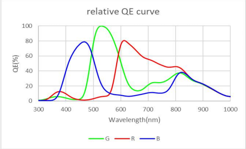

****************
红外夜视
****************

:link_to_translation:`en:[English]`

红外夜视让同一路相机在白天输出正常彩色，在光照不足时改走近红外、输出黑白。``esp_video`` 负责切换红外线截止滤光片（IR-CUT filter）以及红外补光灯，``esp_ipa`` 的控制算法根据统计信息判断何时切换。启用 ISP 流水线后，切换由算法自动完成，应用不必每帧下发命令。

目标与适用场景
--------------

红外夜视主要用于在夜间或光照不足时采集图像：通过配置红外线截止滤光片，并由软件在可见光与近红外之间切换，实现日夜兼顾。适用于以下场景：

1. **安防监控**

   - 家庭 / 商铺 / 仓库的夜间监控，要求看清人物轮廓和行为。
   - 小区周界、停车场等室外区域，避免可见光补光造成光污染或暴露摄像头位置。
   - 监狱、军事基地等高安全等级场所，需 24 小时隐蔽监控。

2. **车载辅助驾驶**

   - 汽车夜视系统：探测前方行人、动物或障碍物，在仪表盘显示黑白图像辅助驾驶员。
   - 倒车影像：无路灯环境下看清后方路况。

3. **野外监测与生态研究**

   - 夜间动物行为观察（如蝙蝠、夜行哺乳动物），不惊扰动物。
   - 防盗猎、森林防火监控。

4. **工业与管道检测**

   - 地下管道、矿井、隧道等完全黑暗环境的巡检机器人。
   - 电力设备内部（如变压器、开关柜）的局部放电检测。

适用前提：输出 RAW、并由片上 ISP 统计亮度与白平衡的传感器（如 ESP32-P4）。已经在传感器内部完成彩色处理的 YUV/RGB 传感器不使用 ``esp_ipa`` 中的控制算法。

解决的问题
----------

白天必须挡住近红外，否则彩色会偏色；夜间移开红外截止滤光片，以便于增强传感器的红外感光能力。需要注意的是，只靠画面亮暗做判断可能引起控制回路振荡：红外灯点亮后画面变亮，算法会误以为到了白天，滤光片刚移开又被移回去。近红外下 Bayer 彩色插值也没有意义，继续输出彩色只会得到假色。

本方案同时处理这三件事：

- 用环境亮度和颜色比例一起判断日夜，红外补光造成的“变亮”不会被当成白天。
- 进入夜视后把饱和度降为 0，输出黑白；回到白天后恢复进入前的饱和度。
- 切换后先静默一段时间，并要求条件连续成立才动作，避免滤光片和曝光还没稳定时再次切换。

方案原理
--------

硬件上，红外线截止滤光片可移入、移出光路。白天滤光片留在光路中，挡住近红外，色彩与可见光一致。夜间滤光片移出，近红外到达传感器；此时打开红外补光灯，即可在无可见光的环境下成像。当前软件自动带动的是滤光片和饱和度，不会开关补光灯。补光灯需要产品自己控制，并与滤光片保持同一日夜状态，否则亮度判断会被灯的开关带偏。

软件每帧看两个彼此独立的现象，两者结论一致才采纳：

- **环境亮度**。优先使用图像分析已经算出的环境亮度（例如 ``env.luma.avg``）。未指定时，用 AE 分区亮度，并按当前增益和曝光折算，避免把“曝光拉满后的亮画面”当成环境很亮。
- **颜色比例**。取 AWB 统计的 G/R（绿通道之和除以红通道之和）。可见光下这个比例反映场景颜色；近红外几乎不受彩色滤光片限制，红通道通常透过更多近红外，G/R 会下降。因此“画面亮但 G/R 偏低”更像红外补光，而不是白天。

两个指标都高于各自门限，才认为明亮；两个都不高于门限，才认为暗淡。缺统计，或两个结论相反，这一帧略过，不触发切换。

白天和夜视使用两套门限，形成滞回。夜视下还会先把环境亮度乘以 ``ir_factor``，用来抵消红外灯点亮带来的亮度跳变。条件需要连续成立一段保持时间才切换。刚进入夜视或刚回到白天后，再静默一段时间，等滤光片到位、自动曝光重新收敛，这段时间不做判断。

一次切换实际做两件事：

- 进入夜视：红外线截止滤光片切到夜间（滤光片移出），饱和度设为 0。
- 回到白天：红外线截止滤光片切到白天（滤光片移入），饱和度恢复为进入夜视前的值。

.. code-block:: text

    白天 ──持续暗淡──► 夜视（静默）──静默结束──► 夜视判断
     ▲                                              │
     │                                              │ 持续明亮
     └──静默结束── 白天（静默） ◄──回到白天─────────┘

硬件需求
--------

软件门限只能补偿已经确定的硬件。传感器近红外响应、镜头透过率、滤光片方案和补光灯没就绪时，先不要调 IPA 参数，也不要把虚焦、看不清、来回切换都当成算法问题。

相机传感器选型要点
^^^^^^^^^^^^^^^^^^

标准 CMOS / CCD 传感器对近红外有响应（硅材料在 350–1050 nm 都有感光能力），但不同传感器的近红外量子效率（QE）差异很大：

- **普通消费级 CMOS**：在 850 nm 处 QE 大约只有 20%～30%，940 nm 处更低。
- **近红外增强型 CMOS**：通过增加硅外延层厚度、背照式结构、像素内光陷阱等设计提升近红外吸收，可以在 850 nm 处使 QE 大于 35%。

.. note::

   近红外波长越长，硅的吸收系数越低、所需吸收深度越大；在有限的有效感光层厚度下，940 nm 的 QE 通常低于 850 nm。

   选型时务必查阅传感器数据手册中的 QE 曲线，确认目标波长（850 nm 或 940 nm）下的量子效率，而不能默认所有 CMOS 都具备可用的红外响应。

下图是 SC2336 的相对量子效率曲线示例。可见光段 R / G / B 差异明显；进入近红外后各通道逐渐重合并下降。850 nm 附近仍有可用响应，接近 940 nm 后继续走低。换传感器时按该传感器手册中的曲线核对，不要套用这张图上的数值。

   SC2336 相对量子效率曲线

光学设计
^^^^^^^^

- **镜头**：镜片镀膜和粘合胶必须允许近红外透过。普通可见光镜头在 850 nm 以后透过率会下降，高级项目需要使用 IR-corrected 红外校正镜头。
- **焦点偏移**：移除红外线截止滤光片后，红外光的焦点与可见光不在同一焦平面，会导致夜视画面虚焦。高级项目设计要么用红外校正镜头补偿，要么在夜间切换时触发一次自动对焦。软件无法消除光学虚焦。
- **滤光片配置**：通常有以下几种配置：

  - 固定红外线截止滤光片：始终阻挡红外，白天色彩准确，但无夜视。
  - 双滤光片切换（ICR）：白天红外线截止滤光片到位，夜间移出并换上全透片，昼夜兼顾，是安防监控的标准方案。本方案驱动的就是这种滤光片。
  - 完全移除滤光片并加装 850 nm 带通滤镜：专用红外系统，只让目标波段通过，屏蔽可见光干扰。

补光系统（主动红外必需）
^^^^^^^^^^^^^^^^^^^^^^^^

完全黑暗环境下，传感器本身无法产生可用信号，必须使用主动红外补光。当前软件自动带动的是滤光片和饱和度，不会开关补光灯。补光灯由产品自己控制，并与滤光片保持同一日夜状态，否则亮度判断会被灯的开关带偏。

- **850 nm 红外 LED**：感光效率高，但有可见的红点，适合一般监控。
- **940 nm 红外 LED**：完全不可见，但传感器 QE 更低，同等功率下照射距离更短。
- **补光功率与距离**：标称 30 m 的红外相机，实际有效距离通常只有 15–20 m；草丛、树叶会大量散射和吸收红外光，为了看清拍摄细节往往需要更近距离或更高功率补光。波长选定后，用 ``ir_factor`` 消化亮度差，而不是改判断逻辑。

ISP 与图像处理
^^^^^^^^^^^^^^

夜间开启红外灯后，ISP 保持现有输出格式，demosaic 等模块仍按原流水线处理。黑白画面来自红外算法把 saturation 设为 0，再下发 ``V4L2_CID_SATURATION``；回到白天后恢复进入夜视前的饱和度。滤光片由 ``V4L2_CID_IRCUT_MODE`` 切换，与输出格式无关。

日夜若要使用不同的 IPA 调参，这是可选的显式切换：应用调用 ``esp_video_isp_pipeline_set_ipa_config()``。红外自动路径不会自行更换配置。

需要配合 LSC 校准、降噪、增益控制、曝光自适应等 ISP 算法，否则近红外图像噪点会很重。若使用 RAW 传感器加外部 ISP（``esp_video`` 场景），IPA 还要处理近红外条件下的 AWB / AE 收敛问题。近红外下颜色本身没有意义，主要是亮度收敛。

如何使用
--------

先确认上一节的传感器、镜头、滤光片和补光灯已经按目标波长装好，再按下面的顺序接入软件。前三步把滤光片交给视频设备，第四步把日夜判断交给 IPA。ISP 流水线控制器会在算法给出结果后自动设置滤光片和饱和度。

1. 使能驱动与算法
^^^^^^^^^^^^^^^^^

红外线截止滤光片驱动、视频设备上的红外线截止滤光片控制、ISP 流水线、红外算法都要打开。MIPI-CSI 与 DVP 按实际接口二选一或同时打开。

.. code-block:: none

    Component config  --->
     Espressif Camera Sensors Configurations  --->
      Camera IRCUT Control Configuration  --->
         [*] AP1511B  --->
     Espressif Video Configuration  --->
      [*] Enable MIPI-CSI based Video Device  --->
         [*] Enable MIPI-CSI IR-Cut Support
      [*] Enable DVP based Video Device  --->
         [*] Enable DVP IR-Cut Support
      [*] Enable ISP based Video Device  --->
         [*] Enable ISP Pipeline Controller
     Espressif Image Process Algorithm Configuration  --->
        [*] IR Algorithm

``AP1511B`` 的切换稳定时间默认 1000 ms，与芯片 CE 引脚上的电容有关。滤光片动作慢、或切换后偶发卡滞时，把该时间加大。

2. 填写初始化引脚
^^^^^^^^^^^^^^^^^

在 ``esp_video_init()`` 使用的 MIPI-CSI 或 DVP 配置里挂上红外线截止滤光片。``ircut_chip_id`` 填 ``0`` 表示启用；不接滤光片时不要填写 ``ircut_config``，或把 ``ircut_chip_id`` 设为 ``255``。未使用的引脚填 ``-1``。

.. code-block:: c

    static esp_video_init_ircut_config_t s_ircut_config = {
        .ircut_chip_id = 0,
        .fbc_pin = GPIO_NUM_10, /* FBC，未连接则填 -1 */
        .en_pin  = GPIO_NUM_11, /* EN，未连接则填 -1 */
    };

    static const esp_video_init_csi_config_t s_csi_config = {
        .ircut_config = &s_ircut_config,
        /* SCCB、reset、pwdn 等按传感器要求填写 */
    };

示例工程可在 ``Example Video Initialization Configuration`` 中打开 ``Enable IR-Cut Control``，并填写 FBC、EN 引脚，无需手写上述结构体。

3. 在 IPA JSON 末尾加入红外参数
^^^^^^^^^^^^^^^^^^^^^^^^^^^^^^^^

把下面的 ``ir`` 写入该传感器的 IPA JSON（``esp_cam_sensor/sensors/<sensor>/cfg/`` 中对应文件），并作为该传感器对象的\ **最后一项**。它要使用本帧里前面模块已经算出的环境亮度和 AWB 统计；写在前面会读到尚未更新的结果。

下面的数值只说明字段含义，不能直接当作产品门限。门限必须用目标场景的白天、黄昏和开灯夜间各采一段再确定。

.. code-block:: json

    "ir": {
        "luma_env": "env.luma.avg",
        "ir_factor": 10.0,
        "enter_delay_us": 500000,
        "exit_delay_us": 500000,
        "normal": {
            "luma_threshold": 0.5,
            "awb_threshold": 1.0,
            "hold_time_us": 2000000
        },
        "ir_mode": {
            "luma_threshold": 0.8,
            "awb_threshold": 0.8,
            "hold_time_us": 3000000
        }
    }

.. list-table::
   :header-rows: 1
   :widths: 28 72

   * - 参数
     - 作用
   * - ``luma_env``
     - 环境亮度来源。推荐 ``env.luma.avg``，与自动曝光使用同一套亮度。省略后由 AE 分区亮度、增益和曝光自行估算，此时用 ``k`` 做曝光折算，用长度为 25 的 ``weight`` 指定分区权重。
   * - ``ir_factor``
     - 夜视下比较前先乘到环境亮度上，补偿红外灯点亮后的亮度跳变。没有红外灯时可保持 ``1.0``。
   * - ``enter_delay_us`` / ``exit_delay_us``
     - 进入夜视、回到白天之后的静默时间，单位微秒。应覆盖滤光片动作和曝光重新收敛。
   * - ``normal``
     - 白天使用的门限。环境亮度和 G/R\ **都**\ 不高于门限，并连续保持 ``hold_time_us``，才进入夜视。
   * - ``ir_mode``
     - 夜视使用的门限，应与 ``normal`` 拉开，避免在临界亮度上来回切换。环境亮度（已乘 ``ir_factor``）和 G/R\ **都**\ 高于门限，并连续保持 ``hold_time_us``，才回到白天。

4. 启动后无需逐帧控制
^^^^^^^^^^^^^^^^^^^^^

``esp_video_init()`` 会探测红外线截止滤光片并挂到对应视频设备。ISP 流水线运行后，算法决定切换时会自动完成滤光片和饱和度设置。应用按原有流程采集图像即可。

只有在不启用红外算法、由应用自己决定日夜时，才对\ **相机设备**\ （MIPI-CSI 或 DVP，不是 ISP 设备）设置 ``V4L2_CID_IRCUT_MODE``：``ESP_CAM_IRCUT_MODE_DAY`` 为白天，``ESP_CAM_IRCUT_MODE_NIGHT`` 为夜视。这条命令只移动滤光片，不改变饱和度。红外算法启用后，下一次自动判定会覆盖手动设置。

调参注意
--------

硬件未按上一节就绪时，不要用这一节的办法去“调算法”。虚焦、看不清、补光不够，都先回到传感器 QE、镜头和灯。

- 先固定补光灯策略，再调门限。灯的开关会改变环境亮度，门限是在“灯会不会亮”已经确定的前提下标定的。
- 白天进夜视偏早：降低 ``normal`` 的亮度门限，或加长 ``normal.hold_time_us``。进入夜视要求亮度不高于该门限，门限越高越容易判成暗。夜间不回白天：提高 ``ir_factor``，或降低 ``ir_mode`` 的亮度门限。回到白天要求亮度乘 ``ir_factor`` 后高于该门限，``ir_factor`` 越小越难退出。临界亮度抖动：拉大两套门限的差距，并加长保持时间。
- 打开 ``enable_log`` 可打印每帧的环境亮度、G/R 和当前是否处于夜视，用于对照实景调整门限。发布版本再关掉。
